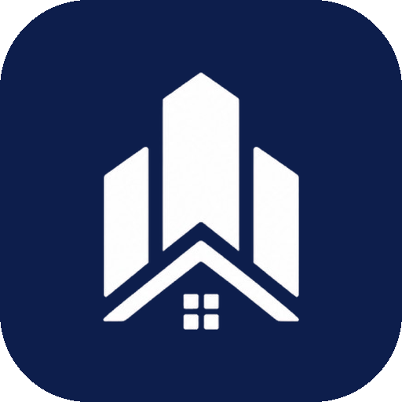
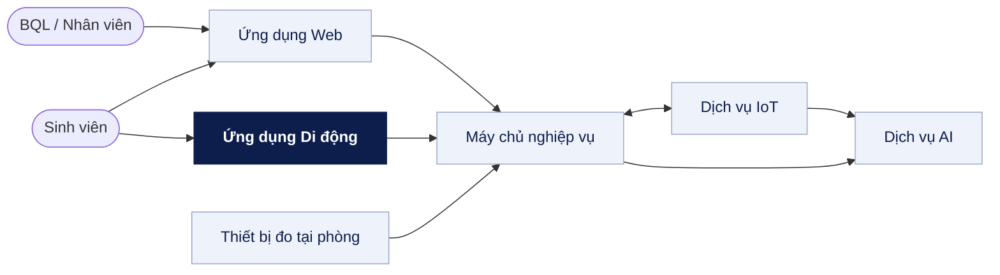

# Smart Dormitory Management System

### Hệ thống quản lý ký túc xá thông minh — Ứng dụng Di động

Mọi thủ tục ký túc xá của sinh viên, gói gọn trong một ứng dụng trên điện thoại.

  
  
  
  
  

[Giới thiệu](#gioi-thieu) · [Điểm nổi bật](#diem-noi-bat) · [Chức năng](#chuc-nang) · [Kiến trúc](#kien-truc) · [Hệ sinh thái](#he-sinh-thai) · [Công nghệ](#cong-nghe)

---

## Giới thiệu

**SDMS – Smart Dormitory Management System** là hệ thống quản lý ký túc xá thông minh, số hóa toàn bộ vòng đời lưu trú của sinh viên: từ **đăng ký, xếp phòng, nhận phòng, đóng tiền, theo dõi điện nước** cho đến **chuyển phòng, trả phòng và hoàn tiền**. Hệ thống kết hợp **thiết bị IoT** đo điện nước tại từng phòng và **trí tuệ nhân tạo** để tự động hóa vận hành, phát hiện sớm sự cố và hỗ trợ sinh viên 24/7.

Repository này là **ứng dụng di động dành cho sinh viên**. Sinh viên dùng chung tài khoản với cổng thông tin web để đăng ký ở, đóng tiền, theo dõi điện nước của phòng, gửi yêu cầu và nhận thông báo ngay trên điện thoại.

## Điểm nổi bật

<table>
<tr>
<td width="50%" valign="top">

**Tự phục vụ mọi lúc** 
Đăng ký, nhận phòng, đóng tiền, gửi yêu cầu — không cần đến văn phòng.

</td>
<td width="50%" valign="top">

**Thanh toán một chạm** 
Thanh toán hóa đơn và phí đăng ký bằng mã QR ngân hàng.

</td>
</tr>
<tr>
<td width="50%" valign="top">

**Minh bạch điện nước** 
Biểu đồ và lịch tiêu thụ theo ngày của chính phòng mình.

</td>
<td width="50%" valign="top">

**Cá nhân hóa** 
Giao diện sáng/tối, chọn màu chủ đạo, song ngữ Việt–Anh.

</td>
</tr>
</table>

## Đối tượng sử dụng

| Vai trò | Công việc chính trên hệ thống |
|---|---|
| **Ban quản lý (BQL)** | Điều hành ký túc xá, mở đợt đăng ký, duyệt hồ sơ, cấu hình giá, theo dõi doanh thu và báo cáo |
| **Nhân viên** | Xử lý yêu cầu sửa chữa, kiểm tra phòng, xác minh sự cố IoT, hỗ trợ sinh viên |
| **Sinh viên** | Đăng ký ở, đóng tiền, theo dõi điện nước, gửi yêu cầu, trò chuyện với nhân viên và trợ lý AI |

## Chức năng chính

| Nhóm chức năng | Mô tả |
|---|---|
| **Trang chủ** | Tổng quan phòng đang ở, hóa đơn cần đóng, thông báo mới và lối tắt đến chức năng thường dùng |
| **Đăng ký ký túc xá** | Xem đợt đăng ký đang mở; nộp đơn theo từng bước; giữ chỗ, hủy đơn; thanh toán phí bằng QR |
| **Nhận phòng & lưu trú** | Nhận phòng và kiểm tra tài sản ngay trên ứng dụng; xem hồ sơ lưu trú |
| **Điện & nước** | Biểu đồ tiêu thụ; lịch tiêu thụ theo từng ngày giúp phát hiện bất thường |
| **Công nợ & thanh toán** | Danh sách hóa đơn, chi tiết từng khoản, biên lai; thanh toán bằng mã QR |
| **Yêu cầu** | Sửa chữa, chuyển phòng, trả phòng; theo dõi tiến độ, tất toán và hoàn tiền |
| **Hỗ trợ** | Trò chuyện trực tiếp với nhân viên ký túc xá |
| **Trợ lý AI** | Hỏi đáp nội quy và thông tin cá nhân; lưu lịch sử trò chuyện |
| **Thông báo** | Nhận thông báo theo thời gian thực |
| **Cá nhân** | Thông tin, ảnh đại diện, đổi mật khẩu; tùy chỉnh giao diện và ngôn ngữ; tự nhắc cập nhật phiên bản mới |

## Kiến trúc tổng thể

Ứng dụng Di động nằm trong hệ sinh thái SDMS như sau *(khối tô đậm là repository này)*:

## Hệ sinh thái SDMS

| Thành phần | Repository | Vai trò |
|---|---|---|
| Ứng dụng Web | [smart-dormitory-management-system](https://github.com/Nhan2kk/smart-dormitory-management-system) | Trang quản trị cho BQL, nhân viên và cổng thông tin sinh viên |
| Máy chủ nghiệp vụ | [smart-dormitory-management-system-server](https://github.com/Nhan2kk/smart-dormitory-management-system-server) | Xử lý nghiệp vụ, phân quyền và dữ liệu trung tâm |
| **Ứng dụng Di động** | **smart-dormitory-management-system-mobile** *(repository này)* | Ứng dụng dành cho sinh viên trên Android, iOS |
| Dịch vụ IoT | [smart-dormitory-management-system-iot](https://github.com/Nhan2kk/smart-dormitory-management-system-iot) | Thiết bị đo tại phòng, xử lý số liệu và đánh giá rủi ro điện nước |
| Dịch vụ AI | [smart-dormitory-management-system-ai](https://github.com/Nhan2kk/smart-dormitory-management-system-ai) | Trợ lý nội quy, tra cứu theo quyền và phát hiện bất thường |

## Công nghệ sử dụng

| Hạng mục | Công nghệ |
|---|---|
| Ngôn ngữ | TypeScript |
| Framework | React Native · Expo |
| Điều hướng | Expo Router |
| Thời gian thực | WebSocket · STOMP |
| Bảo mật phiên đăng nhập | Expo SecureStore |
| Đa ngôn ngữ | Tiếng Việt · English |
| Đóng gói & phát hành | Expo EAS Build |

---

**Smart Dormitory Management System** 
Khóa luận tốt nghiệp · Hệ thống quản lý ký túc xá thông minh · 2026

